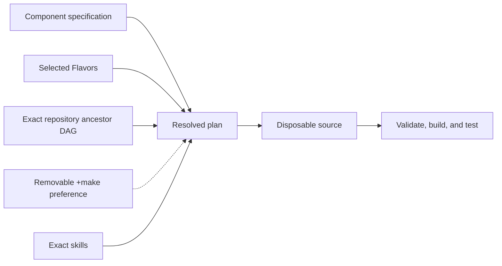

# Project guide

Council of Impossible Furniture is an independent Unprompted AI browser lab. Read its complete
Component specification, inspect the selected Flavors and lock, then build and
run through the Literate AI 1.3.1 harness. Start at the project-root `README.md`.

Start with [getting started](user/getting-started.md) for installation and usage.
See [active work](roadmap/active-work.md) for current development status.

## Development

This project is built with [Literate AI](https://github.com/jordanhubbard/literate-ai).
The [framework flow](user/framework-flow.md) explains the specification-led lifecycle,
and the [project map](user/project-layout.md) identifies the authority for a change.

See [readable specifications](user/specifications.md),
[models and generation](user/models-and-generation.md),
[private test matrices](user/test-matrix.md),
[security](user/security.md), [skill boundaries](architecture/skills.md), and the
[authority learning loop](architecture/authority-learning-loop.md), the
[mission-specification map](architecture/mission-specification-composition.md), and the
[traceability rule](architecture/design-traceability.md) when those concerns apply.

Initialize from an organization or product repository with
`litai init PATH --from URL[#REVISION]`. Literate AI resolves every ancestor without
executing repository code, then records exact commits and inherited catalog provenance.
Use `litai update` to re-resolve that chain and `litai reparent URL|none` to review an
explicit parent change.
